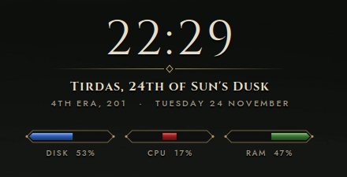

# conky-skyrim-hud

A Skyrim-style HUD widget for [conky](https://github.com/brndnmtthws/conky): big Cinzel clock, the date in the Tamrielic calendar, and Magicka / Health / Stamina bars for disk, CPU and RAM.



- **Time** in Cinzel with a soft shadow and an ornamental divider
- **Tamriel date**: *Tirdas, 24th of Sun's Dusk*, *4th Era 201*, plus the real date
- **Bars**: Magicka = disk used, Health = CPU, Stamina = RAM
- Drawn entirely with Lua + Cairo; no images. Updates every 2 s.

## Install

Needs conky built with Lua and Cairo (`conky-all` on Debian/Ubuntu/Mint).

```sh
sudo apt install conky-all
git clone https://github.com/Shanki200801/conky-skyrim-hud ~/.config/conky/skyrim
```

Fonts (both free, SIL OFL): [Cinzel](https://fonts.google.com/specimen/Cinzel) and [Jost](https://fonts.google.com/specimen/Jost). Download them, put the `.ttf` files in `~/.local/share/fonts/`, and run `fc-cache -f`.

Run it:

```sh
conky -c ~/.config/conky/skyrim/skyrim.conf
```

To start it at login, add that command to your desktop's startup applications (a `sleep 5 &&` in front helps so the desktop is ready first).

## Positioning

By default it sits at the top centre of the screen. To move it, create `~/.config/conky/skyrim/local.lua` (git-ignored) with any conky settings to override:

```lua
return { alignment = 'top_left', gap_x = 1135, gap_y = 1478 }
```

On multi-monitor setups some window managers (e.g. Muffin/Cinnamon) ignore `xinerama_head` for desktop-type windows; use `alignment = 'top_left'` with absolute `gap_x`/`gap_y` instead.

## Credits

Fan-made; not affiliated with or endorsed by Bethesda. *The Elder Scrolls* and *Skyrim* are trademarks of ZeniMax Media. Fonts: Cinzel by Natanael Gama, Jost by Owen Earl (indestructible type*). Built on conky and Cairo.

## License

MIT
